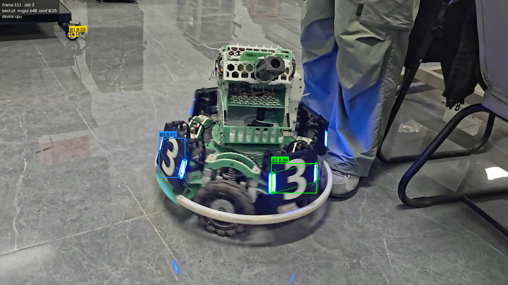
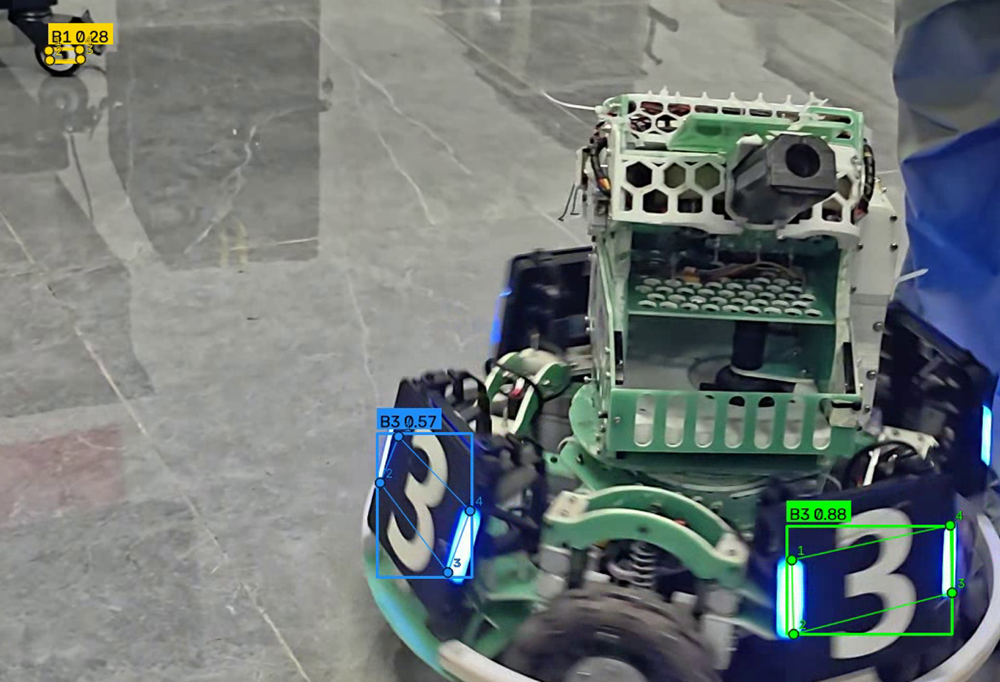
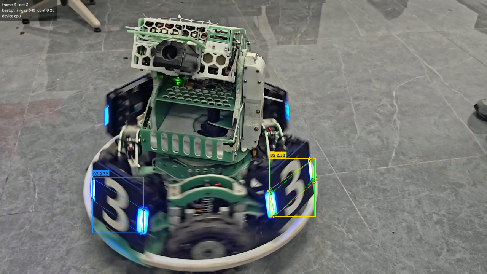

# Color_Sans

RoboMaster 装甲板视频推理与关键点可视化（YOLO26n-pose / Ultralytics）。

本仓库实现「使用指定模型完成推理与可视化」的作业要求：加载课程提供的 YOLO26n 装甲板权重 `best.pt`，
对**自行拍摄的视频**逐帧推理，在结果视频中画出**检测框、类别、置信度和模型预测的 4 个关键点**，
并输出可正常播放的结果视频。

---

## 1. 项目完成的功能

| 功能 | 说明 |
| --- | --- |
| 加载模型权重 | 通过 `--weights` 指定 `best.pt`，启动时打印任务类型、类别名、关键点形状 |
| 读取自己拍摄的视频 | 通过 `--source` 指定，支持 MP4 / MOV / AVI / WebM 等 OpenCV 可解码格式；也支持单张图片 |
| 视频推理 | 逐帧 `model.predict()`，CPU / GPU 均可（`--device`），不要求实时 |
| 目标可视化 | 每个目标绘制：检测框、`类别 + 置信度` 标签、**4 个关键点**（带编号 1–4、与检测框同色，便于看出归属） |
| 关键点连线 | 默认 `--skeleton hull`：按 4 个预测点的凸包描出装甲板轮廓；也可 `order`（按关键点顺序）或 `none`（只画点） |
| 保存结果视频 | 分辨率、帧率与源视频一致，一帧对一帧，`mp4v` 编码，可直接播放 |
| 检测明细（可选） | `--save-txt`：每帧每个目标的框坐标与 4 个关键点坐标写入 txt |
| 运行报告（可选） | `--report-json`：记录权重、参数、模型信息、帧数、检出帧数、置信度统计、关键点总数、耗时与 FPS |
| 无检测自检 | 全片无检测时自动保存首帧用于排查，并打印排查清单（权重 / 视频 / 阈值 / imgsz / 设备） |

关键点**全部来自模型输出** `Results.keypoints`，没有用检测框四角代替；代码中也没有任何关键点后处理。

---

## 2. Python 版本、主要依赖、CPU 还是 GPU

- **Python 版本：3.13.14**（Windows 11 实测）
- **运行设备：CPU**（本次作业实测全部使用 CPU；代码不依赖 GPU，但有 GPU 时可用 `--device 0` 加速）
- **主要依赖（实测版本）**

| 依赖 | 版本 | 作用 |
| --- | --- | --- |
| torch | 2.14.1+cpu | 推理后端 |
| torchvision | 0.29.1+cpu | ultralytics 依赖 |
| ultralytics | 8.4.176 | YOLO 模型加载与推理 |
| opencv-python | 5.0.0.93 | 视频读写与绘制 |
| numpy | 2.5.2 | 数值处理 |

模型元数据（`infer.py` 启动时打印，可用来自查权重是否正确）：

```
任务=pose
类别={0: 'B1', 1: 'B2', 2: 'B3', 3: 'R1', 4: 'R2', 5: 'R3'}
关键点形状=[4, 2]
```

即：6 类（红/蓝方 1、2、3 号装甲板），每个目标 4 个关键点，关键点为 `(x, y)` 两个分量，
**该权重不输出每个关键点的置信度**（详见第 7 节问题 1）。

---

## 3. 模型权重的准备方式与放置位置

权重体积较大，**不进入 Git 历史**（已在 `.gitignore` 中排除），需要自行放入：

1. 取得作业提供的模型权重文件 `best.pt`（yolo26n-pose 装甲板模型，约 5.9 MB）。
2. 在仓库根目录新建 `weights/` 目录，把文件放成：

```
weights/best.pt
```

3. 若放在别处，运行 `infer.py` 时用 `--weights` 指定即可，例如
   `--weights D:\models\best.pt`。

自查权重是否加载正确（无需视频）：

```bash
python infer.py --source 任意一张图片.jpg --weights weights/best.pt
```

启动日志中的 `任务 / 类别 / 关键点形状` 与第 2 节一致即说明权重正确。

---

## 4. 依赖安装步骤、实际运行命令、结果保存位置

### 4.1 安装依赖

```bash
# 1) 创建并激活虚拟环境（虚拟环境不入库）
python -m venv .venv
.venv\Scripts\activate            # Windows
# source .venv/bin/activate       # Linux / macOS

# 2) 安装 CPU 版 torch（体积大，建议单独指定官方 CPU 源，避免误装 CUDA 版）
pip install torch torchvision --index-url https://download.pytorch.org/whl/cpu

# 3) 安装其余依赖
pip install -r requirements.txt
```

> 使用 NVIDIA GPU 时：把第 2 步换成 PyTorch 官网对应 CUDA 版本的安装命令
> （例如 `pip install torch torchvision --index-url https://download.pytorch.org/whl/cu128`），
> 运行时加 `--device 0`。
>
> 国内网络较慢时可加镜像，例如 `-i https://pypi.tuna.tsinghua.edu.cn/simple`。

### 4.2 实际运行命令（本次作业实测使用）

```bash
python infer.py ^
  --weights weights/best.pt ^
  --source videos/d414.mp4 ^
  --output runs/d414_result.mp4 ^
  --device cpu --imgsz 640 --conf 0.25 ^
  --save-txt --report-json runs/d414_report.json
```

### 4.3 结果保存位置

| 产物 | 路径 | 是否入库 |
| --- | --- | --- |
| 结果视频 | `runs/d414_result.mp4` | 否 |
| 检测明细 | `runs/d414_detections.txt` | 否 |
| 运行报告 | `runs/d414_report.json` | 否 |
| 结果截图 | `docs/*.png` | **是** |

输出路径可用 `--output` 任意指定；不给 `--output` 时默认写到 `runs/<源文件名>_result.mp4`。

### 4.4 常用参数

| 参数 | 默认值 | 说明 |
| --- | --- | --- |
| `--weights` | `weights/best.pt` | 模型权重路径 |
| `--source` | `videos/d414.mp4` | 输入视频或图片路径 |
| `--output` | `runs/<源名>_result.mp4` | 结果视频/图片保存路径 |
| `--device` | `cpu` | `cpu` 或 `0`（GPU） |
| `--imgsz` | `640` | 推理输入尺寸 |
| `--conf` | `0.25` | 置信度阈值 |
| `--iou` | `0.7` | NMS IoU 阈值 |
| `--max-det` | `30` | 单帧最大检测数 |
| `--kpt-conf` | `0.0` | 关键点置信度显示阈值（低于阈值画空心；本权重无关键点置信度，该参数不生效） |
| `--skeleton` | `hull` | 关键点连线：`hull` / `order` / `none` |
| `--line-width` / `--kpt-radius` / `--font-scale` | `2` / `5` / `0.6` | 绘制样式 |
| `--no-hud` | 关闭 | 不显示左上角信息面板 |
| `--max-frames` | `0` | 只处理前 N 帧（0 = 整段），用于快速自检 |
| `--codec` | `mp4v` | 输出编码，打不开时自动回退 XVID(`.avi`) |
| `--show` | 关闭 | 实时弹窗预览（按 q 退出） |
| `--save-txt` / `--report-json` | 关闭 | 输出检测明细 / 统计报告 |

模型路径、视频路径、输出位置都在命令行参数里，无需改代码。

---

## 5. 视频拍摄地点、时长及场景说明

- **拍摄地点**：D414 实验室（室内水泥地面，有顶部照明）
- **视频格式**：手持拍摄，1920×1080、30.006 FPS、HEVC 编码、12.3 MB（文件名 `video_20261012_215837..mp4`）
- **时长**：8.80 秒，共 264 帧
- **场景说明**：拍摄对象为一台 RoboMaster 步兵机器人（蓝方，装甲板上可见数字“3”），
  镜头与机器人之间存在相对运动，画面中包含：
  - 机器人两侧的装甲板（不同角度、不同远近，部分帧存在运动模糊）；
  - 第 111 帧等处画面边缘远处还有一块小尺寸装甲板，用于观察小目标检出情况。
- **原始视频放置位置**：`videos/d414.mp4`（不入库，需自行放入）

---

## 6. 能展示检测框和关键点的代表性结果截图

结果视频第 111 帧（画面清晰，同时检出 3 个目标：B3 0.88、B3 0.57、B1 0.28）：



关键点细节放大（左上 1 → 左下 2 → 右下 3 → 右上 4，轮廓贴合装甲板四角，
关键点与检测框同色、带编号，可清楚看出每个点属于哪个目标）：



第 3 帧（同一辆车的两块“3”号装甲板被分别判为 B3 0.32 与 B2 0.32，属低置信度下的类别混淆，
保留真实结果作为记录）：



---

## 7. 实际识别表现、遇到的问题及处理方法

### 7.1 实际识别表现（`runs/d414_report.json` 实测）

| 指标 | 数值 |
| --- | --- |
| 处理帧数 | 264 / 264（全片） |
| 检出目标的帧数 | 261（3 帧无检测：第 23、140、149 帧） |
| 检测目标总数 | 387 |
| 每帧检测数分布 | 1 个：154 帧；2 个：88 帧；3 个：19 帧 |
| 关键点总数 | 1548（= 387 × 4，**每个目标都恰好 4 个关键点，无缺失**） |
| 检测框平均置信度 | 0.688（最低 0.251，中位 0.773，最高 0.895） |
| 置信度 ≥ 0.8 / < 0.4 | 180 个 / 61 个 |
| 耗时 | 13.68 s（CPU，含读写视频；纯推理约 19.3 FPS） |
| 结果视频 | 1920×1080、30.006 FPS、264 帧、mp4v，与源视频一一对应 |

分类别表现：

| 类别 | 检出次数 | 平均置信度 | 置信度范围 |
| --- | --- | --- | --- |
| B3 | 316 | 0.731 | 0.251 – 0.895 |
| B2 | 65 | 0.513 | 0.266 – 0.766 |
| B1 | 6 | 0.273 | 0.256 – 0.315 |

**现象记录（未做任何"挑好看的帧"处理）：**

1. 主体装甲板识别稳定：B3 板在多角度下都能稳定检出，多数帧置信度 0.6 以上，关键点落在装甲板四角。
2. **低置信度下的类别混淆**：第 3 帧两块都印着"3"的装甲板被判为 `B3 0.32` 与 `B2 0.32`，
   其中一块应为 B3。这类错误集中在置信度 0.25–0.40 区间（全片 61 个低置信度目标）。
3. **小目标检出偏弱**：B1 全片仅 6 次，置信度 0.256–0.315，出现在画面边缘、面积很小的远处装甲板上。
4. **漏检 3 帧**（23、140、149）：均为运动模糊明显的帧。

以上现象只做记录，未通过调参掩盖；`.gitignore` 排除的 `runs/d414_detections.txt`
保留了每帧每个目标的框与关键点坐标，可逐条复核。

### 7.2 遇到的问题及处理方法

**问题 1：该权重不输出关键点置信度。**
`kpt_shape=[4, 2]`，即关键点只有 `(x, y)`，`Results.keypoints.conf` 为 `None`。
如果按"置信度过滤"来画点，4 个关键点会被全部丢掉。
处理：绘制逻辑不依赖关键点置信度，`conf` 为 `None` 时按可见处理，保证**4 个点全部画出并编号**；
`--kpt-conf` 的空心标记只对带置信度的模型生效；报告中 `mean_kpt_conf` 为 `null` 属正常现象。

**问题 2：关键点顺序与连线。**
实测该权重的关键点顺序为「左上 → 左下 → 右下 → 右上」，按顺序连线正好是装甲板轮廓；
但为了不依赖具体权重的顺序约定，默认用 `--skeleton hull`（对 4 个预测点求凸包再描边），
效果等价且更稳；需要严格按模型顺序连线时用 `--skeleton order`。

**问题 3：检测明细里关键点为空（已修复）。**
最初写 txt 时用 `zip(kxy, kcf)`，而 `kcf` 在本权重下为 `None`，导致文本里的 `kpts=[]` 为空，
但视频里的关键点是正常画出的（两者用了不同代码路径）。
处理：抽出 `kpt_pairs()` 统一处理 `conf=None` 的情况，现在 txt 中每个目标都记录 4 个点，
报告中 `keypoints_per_target` 为 4.0，可反向校验。

**问题 4：ultralytics 首次导入时因配置目录无写权限而报错。**
`ultralytics` 会在 `%APPDATA%\Ultralytics` 创建配置文件，若该目录无写权限，
导入阶段直接抛 `PermissionError`。
处理：把配置目录指到有写权限的位置即可（本次实测即如此）：

```bash
set YOLO_CONFIG_DIR=D:\path\to\writable\dir     # Windows
export YOLO_CONFIG_DIR=/path/to/writable/dir    # Linux / macOS
```

**问题 5：视频编码兼容性。**
源视频为 HEVC，OpenCV 可正常解码；输出默认用 `mp4v`（Windows 播放器 / VLC / 浏览器均可播放）。
若某些环境没有对应编码器，脚本会自动回退到 `XVID` 并输出 `.avi`，保证结果视频一定能播放。

**问题 6：全片没有有效检测时的排查流程。**
脚本内建了自检：当 `detections_total == 0` 时，会把源视频首帧保存为
`runs/<源名>_first_frame.jpg` 并打印排查清单。排查顺序为：
① 权重是否为本次任务的 `best.pt`（看启动打印的 任务/类别/关键点形状）；
② 视频能否正常播放、内容是否为装甲板；
③ 降低阈值 `--conf 0.10`；
④ 提高输入尺寸 `--imgsz 960`；
⑤ 确认 `--device` 可用。
本次实测未触发该分支（261/264 帧均有检出）。

---

## 8. 文件结构

```
Color_Sans/
├── infer.py                     # 推理与可视化脚本（唯一入口）
├── requirements.txt             # 依赖说明
├── README.md                    # 本文件
├── .gitignore                   # 排除权重 / 视频 / 结果 / 虚拟环境
├── docs/                        # 结果截图（入库）
│   ├── result_frame_0003.png
│   ├── result_frame_0111.png
│   └── keypoints_zoom_frame0111.png
├── weights/                     # 放入 best.pt（不入库）
├── videos/                      # 放入自行拍摄的原始视频（不入库）
└── runs/                        # 结果视频、检测明细、报告（不入库）
```

## 9. 仓库不包含哪些文件、如何准备

`.gitignore` 已排除**模型权重、原始视频、结果视频、虚拟环境**，避免大文件进入 Git 历史：

| 被排除的内容 | 需要自行准备的方式 |
| --- | --- |
| `weights/*.pt` | 从课程材料取得 `best.pt`，放入 `weights/` |
| `videos/*` | 自行拍摄的原始视频，放入 `videos/`（本次为 D414 实验室拍摄的 8.8 s 视频） |
| `runs/*` | 运行 `infer.py` 后自动生成（结果视频、明细、报告） |
| `.venv/` | 按第 4.1 节创建虚拟环境 |

因为权重与原始视频不入库，**克隆仓库后必须按第 3、5 节补齐这两个文件，再执行第 4.2 节命令**，
即可复现上面的结果视频与统计数字。

## 10. 完整复现步骤

```bash
git clone https://github.com/ZengJiaqi404/Color_Sans.git
cd Color_Sans
git checkout feat/yolo-inference

python -m venv .venv
.venv\Scripts\activate
pip install torch torchvision --index-url https://download.pytorch.org/whl/cpu
pip install -r requirements.txt

# 放入 weights/best.pt 与 videos/d414.mp4 后：
python infer.py --weights weights/best.pt --source videos/d414.mp4 ^
                --output runs/d414_result.mp4 --device cpu ^
                --save-txt --report-json runs/d414_report.json
```
